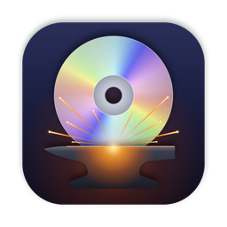

# dvdForge

A macOS app for archiving DVDs before they rot. It reads each disc defensively,
works around scratches the way data-recovery tools do, and writes **lossless
MKV** files: the disc's own video and audio, bit for bit, with chapters,
languages and subtitles.

Made by [bluepill.ca](https://bluepill.ca).

## Features

- **Lossless.** MPEG-2 video, AC3, DTS and MPEG audio, and DVD subtitles are
  copied without re-encoding. LPCM (uncompressed) audio, which Matroska can't
  hold, becomes FLAC, which is also lossless.
- **Built for damaged discs.** Reading is multi-pass and resumable, following
  [GNU ddrescue](https://www.gnu.org/software/ddrescue/):
  1. **Read.** 1 MiB at a time. After an error it jumps ahead with a growing
     gap and switches to small reads, so the healthy disc comes off first.
  2. **Narrow down.** Reads inward from both edges of each damaged area to find
     exactly where the damage starts and stops.
  3. **Retry.** Retries the damaged core one ECC block (16 sectors) at a time at
     low drive speed, in rounds, stopping once a round recovers nothing.
  4. **Verify** (optional). Re-reads everything and compares, catching drives
     that return wrong data without reporting an error. *Auto* (the default)
     runs it only when the disc produced read errors, so healthy discs rip at
     full speed.

  A watchdog notices reads the drive is stuck on and records them at once. If
  the drive resets or drops off the USB bus, the rip resumes automatically when
  the disc comes back, without walking back into the area that caused it. You
  can stop retrying at any time and keep everything already read.
- **Shows its work.** A live sector map, a close-up of any damaged area, what
  the drive is doing right now, and an activity log of every decision.
- **Rip reports.** Each MKV gets a `.dvdforge.json` beside it: drive, passes,
  read errors, damaged areas with chapter and timestamp, tracks and the
  activity log. The Rip History window (⌘⇧Y) lists them.
- **Named properly.** With a free [TMDb](https://www.themoviedb.org) API key,
  discs are identified and saved as `Title (Year)/Title (Year).mkv`, the
  convention Plex, Jellyfin and Infuse expect. The match is chosen by running
  time, with a chooser when it's ambiguous. Without a key, the disc label is used.
- **Batch friendly.** Optionally rip the main feature as soon as a disc goes in
  and eject when it's done, with a chime: insert, wait, swap.
- Picks the main feature automatically, skipping the duplicate titles of
  structure-protected discs. Language preferences decide which audio and
  subtitle tracks are kept and which audio is the default.
- Also opens ISO images, `VIDEO_TS` folders and `.dvdmedia` bundles.

## Requirements

- macOS 15 or later, on Apple Silicon or Intel
- A DVD drive (USB is fine; see [Drive tips](#drive-tips))
- To build: Xcode 27 (what it's developed with) and [Homebrew](https://brew.sh)

## Download

Signed and notarised builds are on the
[Releases](https://github.com/a-grah/dvdforge/releases) page: open the DMG and
drag dvdForge to Applications. From 1.1 on, the app updates itself
(**dvdForge → Check for Updates…**, or automatically if you allow it).

## Building

```sh
brew install xcodegen meson ninja pkg-config
git clone --recursive <this repository> dvdForge
cd dvdForge
xcodegen generate          # builds the libraries, then creates dvdForge.xcodeproj
open dvdForge.xcodeproj    # or: xcodebuild -scheme dvdForge build
```

`xcodegen generate` first runs `Scripts/build-deps.sh`, which compiles the
vendored libdvdcss, libdvdread and a minimal FFmpeg for both architectures
into `Vendor/build/DiscDeps.xcframework`. That takes a few minutes the first
time and is skipped afterwards; `Scripts/build-deps.sh --force` rebuilds it.

The app isn't sandboxed (raw access to the drive requires that) and is signed
ad hoc for local use.

### Making a release

`Scripts/release.sh` builds, signs with your Developer ID (hardened runtime),
notarises and staples the app, then packages it as a notarised DMG in `dist/`
(window background from `Scripts/make-dmg-background.swift`). It needs
`brew install create-dmg`, a *Developer ID Application* certificate and a
notarytool profile:

```sh
xcrun notarytool store-credentials dvdforge-notary --apple-id <you@example.com> --team-id <TEAMID>
Scripts/release.sh
```

`DVDFORGE_SIGN_IDENTITY` and `DVDFORGE_NOTARY_PROFILE` override the defaults.

GitHub Actions does the same on a tag, and also signs the DMG for
[Sparkle](https://sparkle-project.org) and attaches the `appcast.xml` the app
checks for updates (always read from the latest release). Bump
`MARKETING_VERSION` in `project.yml`, commit, then:

```sh
git tag v1.1 && git push origin main v1.1
```

`.github/workflows/release.yml` builds, signs, notarises and publishes the
release. It needs the secrets listed at the top of that file. Running it by
hand from the Actions tab is a dry run that publishes nothing. `ci.yml` builds
and runs the tests on every push and pull request.

Publish releases through the workflow rather than by hand, so each one carries
its appcast. Forks need their own Sparkle key: change `SUPublicEDKey` and
`SUFeedURL` in `project.yml`.

### Tests

```sh
brew install ffmpeg dvdauthor   # used to build test discs and check output
xcodebuild -scheme dvdForge test
```

The test scheme builds a small DVD image (`Scripts/make-fixture.sh`) with
several titles, chapters, AC3 and LPCM audio, subtitles and a clock restart.
It then checks the disc parser; the reader against simulated scratches,
intermittent errors, silent corruption, stuck reads and drive loss; and the
MKVs, which must be bit-identical to the disc's streams.

## Setting up title lookup

1. Create a free account at [themoviedb.org](https://www.themoviedb.org).
2. In its settings, under **API**, request a key. Either the *API Key* or the
   *API Read Access Token* works.
3. In dvdForge, open **Settings → Online Lookup**, paste it, and click
   **Save & Test**.

The key is stored in your login keychain, never in the app or this repository.

## Using it

Insert a disc. It's read and listed with the main feature selected; adjust
titles and tracks if you like, then press **Rip** (⌘↩). MKVs go to
`~/Movies/dvdForge` (configurable). The raw read is staged in
`~/Library/Caches` and removed afterwards unless you choose to keep it.

Settings worth knowing:

| Setting | What it does |
|---|---|
| Verify read | Off / **Auto** / Always. Always doubles rip time on every disc. |
| Retry rounds for damaged areas | Most rounds the retry pass will make (it stops early once a round recovers nothing). |
| Preferred languages | e.g. `en, fr`. Choose which tracks to keep and the default audio. |
| Batch | Rip on insert; eject when finished. |

If a rip stops partway (cancelled, or the drive went away), selecting the same
title again offers **Resume** or **Finish Without Retrying**. The second reads
whatever hasn't been read and leaves the damaged area alone.

## Drive tips

Learned the hard way with a slim USB drive:

- **Most drives limit DVD-Video to about 4×** to stay quiet, so expect 25–40
  minutes for a dual-layer disc. Older LG and ASUS drives are often faster.
- **On a bad scratch, a drive can retry one read internally for minutes,**
  sometimes until it resets or drops off USB. dvdForge copes, and it records
  stuck areas so a resume skips them. If the drive stays stuck, unplugging it
  and plugging it back in ends the wait, and the rip resumes by itself.
- **Bus-powered drives can brown out under that strain.** Plug straight into
  the Mac, or use the drive's Y-cable or a powered hub.
- **Clean scratched discs before ripping;** it often turns unreadable areas
  readable.

## Project layout

```
DvdForge/          SwiftUI app
  App/             app, model, settings, About panel
  Disc/            disc model and browser UI, track preferences
  Drive/           drive and disc detection (IOKit, DiskArbitration)
  Lookup/          TMDb client, label clean-up, match picking, keychain
  Rip/             rip session, progress UI, reports, history
DiscCore/          C++ engine, used from Swift through DiscCore.hpp
  src/DiscInfo     IFO parsing (titles, chapters, cells, tracks)
  src/ResilientReader  the multi-pass reader
  src/MkvRemuxer   MPEG-PS → Matroska, with clock-segment handling
Scripts/           dependency build, test fixtures, icon rendering
Vendor/src/        libdvdcss, libdvdread, FFmpeg (git submodules, pinned)
```

Development launch arguments: `-open <path>` opens an image or folder at
launch, `-outputFolder <path>` overrides the output folder, and
`-simulateDamage 1000-4000@300` makes sectors 1000–3999 fail, 300 ms each,
to try out the damage handling without a scratched disc.

## Legal

dvdForge decrypts CSS-protected discs using libdvdcss so you can keep a
personal backup of discs you own. The law on this varies by country (in the
US, for example, the DMCA restricts circumvention); it's your responsibility
to know and follow the law where you live.

This product uses the TMDB API but is not endorsed or certified by TMDB.

## License

Copyright © 2026 bluepill.ca

dvdForge is free software: you can redistribute it and/or modify it under the
terms of the GNU General Public License as published by the Free Software
Foundation, either version 2 of the License, or (at your option) any later
version. See [LICENSE](LICENSE).

It includes [libdvdcss](https://www.videolan.org/developers/libdvdcss.html)
and [libdvdread](https://www.videolan.org/developers/libdvdnav.html) (GPL-2.0
or later) and [FFmpeg](https://ffmpeg.org) (built as LGPL-2.1 or later), each
under its own license in `Vendor/src/`, and uses
[Sparkle](https://sparkle-project.org) (MIT) for updates.
